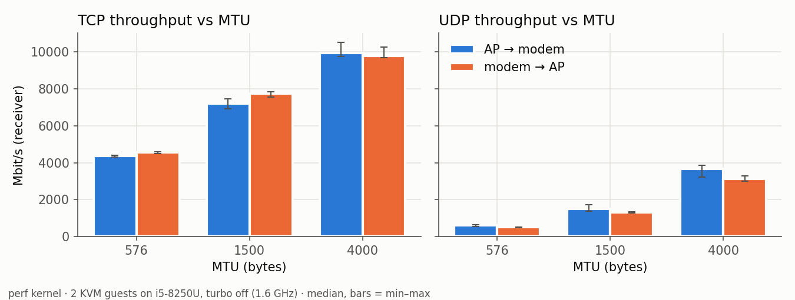
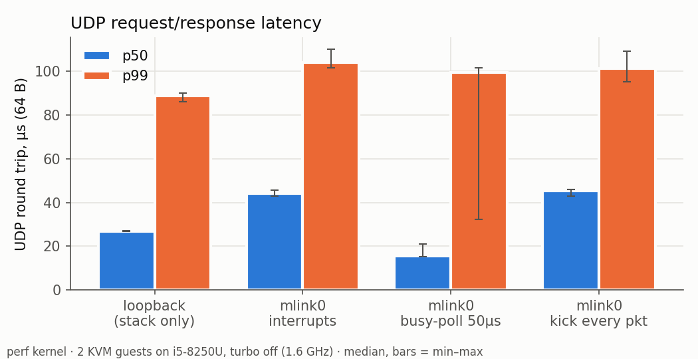

# mlink — Linux Network Driver for a Shared-Memory Modem Link

An out-of-tree Linux PCI network driver that rebuilds, in miniature, the data path between a
phone's **application processor (AP)** and its **modem**: two KVM guests share memory through
QEMU's `ivshmem-doorbell` device, and each runs `mlink.ko`, which exposes a **raw-IP
point-to-point `net_device` (`mlink0`)** with **MSI-X doorbells, NAPI, lock-free SPSC rings in
shared memory**, and **subsystem-restart (SSR) recovery** when the other side dies.

```
 VM "ap"                                              VM "modem"
  TCP/IP stack                                         TCP/IP stack
  mlink0 (raw IP, NAPI) ─────── 4 MiB shared memory ─── mlink0
  mlink.ko role=ap      ◄── doorbell → MSI-X ──►        mlink.ko role=modem
        └──────── QEMU ivshmem-doorbell + ivshmem-server (KVM host) ────────┘
```

| Snapdragon concept | mlink equivalent |
|---|---|
| SMEM (shared memory) | ivshmem BAR2, ABI in `driver/mlink_shm.h` |
| IPCC / mailbox interrupts | ivshmem doorbell → peer MSI-X vector |
| MHI / BAM-DMUX channels, `mhi_net`, `rmnet` | descriptor rings + raw-IP netdev with NAPI |
| Subsystem Restart (SSR) | heartbeat/ring-progress watchdog + generation handshake |

## Status

Phases 0–7 implemented, plus a Zephyr modem (P8.1–P8.2). Correctness tested on a debug kernel (KASAN, lockdep, kmemleak);
numbers measured on a perf kernel. Full methodology and caveats: [`docs/results.md`](docs/results.md).

## Results (perf kernel, laptop CPU fixed at 1.6 GHz, medians of 5)

| What | Result |
|---|---|
| TCP throughput, MTU 1500 / 4000 | **7.2 / 9.9 Gbit/s** (AP→modem), 2 retransmits in 30 runs |
| Doorbell round trip (IRQ→IRQ) | **13.1 µs** p50, 22.5 µs p99, 0 lost / 50 000 |
| UDP 64 B request/response | **44 µs** p50 with interrupts, **15.5 µs** p50 with busy-poll |
| Interrupt mitigation | 1.0 → **0.47** RX interrupts per packet from light to full load |
| TCP after checksum offload across the link (D17) | **7.8 / 11.1 Gbit/s** at MTU 1500 / 4000 |
| Subsystem restart, both drivers, live TCP | **90 ms** outage, TCP survives |
| Peer VM killed | detected **520 ms** after its last heartbeat; re-handshake with the new peer ID |
| Shared-memory corruption (1 201 ops, 7 modes) | no crash, KASAN clean, recovery ≤ 3.2 s |




## What's in it

- **PCI/MSI-X driver** (`mlink_main.c`): managed resources, 4 vectors (DATA, SPACE, STATE,
  TEST), BAR2 mapped write-back with `virt_*` barriers, careful teardown ordering.
- **SPSC rings** (`mlink_ring.c`): free-running indices, release/acquire publication, single-
  fetch validation of every peer-written field, **kick suppression** (store-buffering pattern
  with full barriers) — verified with **LKMM litmus tests** (`litmus/`).
- **Raw-IP netdev** (`mlink_net.c`): `ARPHRD_RAWIP` like `mhi_net`, NAPI + GRO, queue
  stop/wake with re-check, `xmit_more` batching, `u64_stats`, ethtool `-S`, tracepoints.
- **Link state machine & SSR** (`mlink_link.c`): two-way generation handshake, heartbeat or
  ring-progress liveness, reset that quiesces the data path without locks in it, STATE-vector
  fast path for graceful restarts.
- **Control plane** (`mlink_ctrl.c`): `/dev/mlink_ctrl` with QMI-like request/response/
  indication messages over two more rings and a 5th MSI-X vector; `mlinkd` (modem daemon) and
  `mlinkctl` (AP CLI); SSR-aware (pending requests fail with `ENOTCONN`), unbind-safe lifetime.
- **Zephyr modem** (`zephyr/mlink-modem`): the modem side as a Zephyr RTOS image (276 KB RAM)
  that compiles the driver's `mlink_ring.c` unchanged through a small `virt_*`/`READ_ONCE`
  shim; loopback test mode (ICMP echo → reply with RFC 1624 checksum update, UDP reflected);
  restarts detected by the AP via generation change (recovery 44–53 ms) or heartbeat (521 ms).
  Or, built with `net.conf`, the ring pair becomes a raw-IP Zephyr network interface with the
  real Zephyr TCP/IP stack (TCP echo verified byte-exact, UDP echo, ping).
- **Hardening**: host-side **shared-memory corruption injector** (`tools/shm_chaos.c`),
  driver fault knobs, lost-kick watchdogs on local facts only, header self-repair;
  `checkpatch --strict`, sparse and `W=1` clean.

## How to run

Full rebuild-from-zero instructions: [`docs/environment.md`](docs/environment.md). In short:
```bash
bash scripts/win/rbuild.sh        # sync to the KVM host, build mlink.ko, stage to the guests
bash scripts/win/test.sh          # smoke test: load, link up, ping, iperf3, unload, dmesg gate
ssh mlink-ap 'bash /mnt/share/mlink-up.sh ap'; ssh mlink-modem 'bash /mnt/share/mlink-up.sh modem'
ssh mlink-ap 'ping 10.77.0.2'
```

## Design & study material
- [`docs/design.md`](docs/design.md) — layout, vectors, ring protocol, state machine.
- [`docs/walkthrough/`](docs/walkthrough) — per-phase line-by-line explanations.
- [`docs/debugging-log.md`](docs/debugging-log.md) — the bugs found and how.

## Prior art (and what's different)
- Siemens Jailhouse **`ivshmem-net`** (out-of-tree Ethernet over ivshmem) — read as prior art.
- Linux **`mhi_net`**, **`rmnet`** (modem raw-IP netdevs), **`virtio_net`** (rings, kick
  suppression). mlink's focus: modem-style raw-IP semantics, SSR, fault injection, memory-model
  verification and measured numbers — not novelty of the transport.

## Limitations
Not a production driver: fixed layout, copy-based (two copies per packet), x86-only memory
ordering tested at runtime (LKMM covers the model), single queue, peers are VMs on one host (the Zephyr modem runs under TCG and does not
serve the control plane). Numbers are VM-to-VM on a 2017 laptop CPU.

## License
GPL-2.0-only. See [LICENSE](LICENSE).
