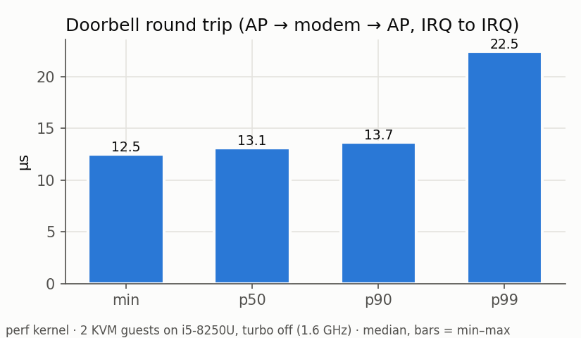
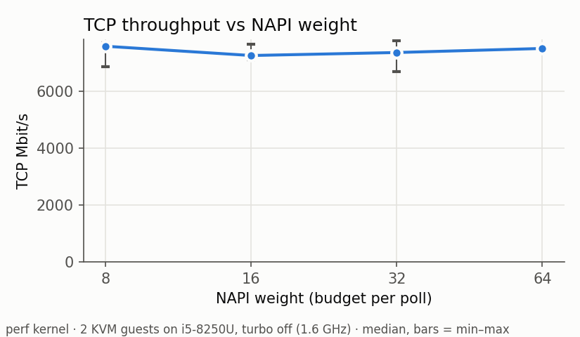
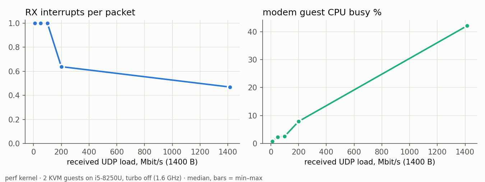

# mlink — results

Every number below is computed from a committed raw file (named in each section) produced by
the command shown. Headline numbers come from the **perf kernel** only. Debug-kernel numbers
(KASAN + lockdep + kmemleak) are labelled and used only for correctness evidence.

## Setup and methodology

| | |
|---|---|
| Host | Kali laptop, Intel i5-8250U (4 cores / 8 threads), 7.6 GB RAM, host kernel 6.16 |
| Hypervisor | QEMU 10.2.2 + KVM, `ivshmem-doorbell` (4 MSI-X vectors), `ivshmem-server`, 4 MiB shm |
| Guests | 2 × (2 vCPU, 1 GiB), Debian 13, guest kernel **6.18.59-mlink-perf** (no debug options) |
| Driver | `mlink.ko` at the commit of this file; ring 256 × 4 KiB slots per direction |
| Hygiene (P6.2) | `bench-prep.sh`: governor `performance`, **turbo off (fixed 1.6 GHz)**, caches dropped, background apps stopped, **ap pinned to CPUs 0,1, modem to CPUs 2,3** (separate physical cores) |
| Repetitions | 5 per point (3 for E5), 10 s each, one warm-up run discarded; **medians**, min–max shown in plots |
| Command | `ON_HOST=1 bash bench/run_matrix.sh 5 10` (on the laptop) → `bench/results/perf/*.csv`, raw log `matrix-raw.log` |

Turbo is off for thermal safety (this laptop's critical trip is 98 °C, see the debugging log)
and for low variance; absolute numbers are therefore **conservative** for this CPU. Peak
temperature during the matrix: 56 °C.

## E1 — Doorbell round trip (`e1_doorbell.csv`)

AP kicks the TEST vector → modem's hard-IRQ handler kicks back → AP's handler timestamps.
Interrupt-to-interrupt, no network stack. 5 × 10 000 round trips, **0 lost**.

| min | p50 | p90 | p99 | max |
|---|---|---|---|---|
| 12.5 µs | **13.1 µs** | 13.7 µs | 22.5 µs | 330 µs |

This is the floor of every cross-VM notification: two MMIO doorbell writes (VM exits),
two eventfd → MSI-X injections, two guest interrupt entries.

## E2 — Throughput vs MTU (`e2_mtu.csv`)

iperf3, receiver-side Mbit/s, medians of 5. TCP retransmits over all 30 TCP runs: 2. UDP loss: 0 %.

| | MTU 576 | MTU 1500 | MTU 4000 |
|---|---|---|---|
| TCP AP→modem | 4 374 | **7 202** | **9 932** |
| TCP modem→AP | 4 553 | 7 754 | 9 790 |
| UDP AP→modem | 622 | 1 515 | 3 654 |
| UDP modem→AP | 509 | 1 307 | 3 126 |

- Throughput scales with MTU: the cost is per packet (descriptor, kick decision, skb alloc,
  two copies, stack traversal), so bigger packets amortise it.
- UDP is far below TCP because iperf3's UDP sender pays one `sendto()` syscall per datagram;
  TCP batches through GSO/GRO (GRO merges segments on the receiver in our NAPI path).
- Each packet is copied twice (sender into the slot, receiver out of it). At 9.9 Gbit/s that
  is ~2.5 GB/s of memcpy through a 4 MiB shared region on a 1.6 GHz core.

## E3 — NAPI weight (`e3_napi.csv`)

TCP AP→modem, MTU 1500, modem module reloaded with `napi_weight=W`.

| weight | Mbit/s | NAPI polls/s | polls that used the whole budget |
|---|---|---|---|
| 8 | 7 579 | 85 833 | 799 381 |
| 16 | 7 253 | 41 616 | 348 631 |
| 32 | 7 359 | 22 245 | 148 179 |
| 64 | 7 501 | 14 035 | 68 378 |

Throughput is flat (within run-to-run noise); the budget only changes **how often** the
softirq re-polls: 6× fewer polls at 64 than at 8. On a busier system a small weight trades
throughput for fairness with other softirq work; here nothing else competes.

## E4 — UDP request/response latency (`e4_latency.csv`)

`tools/udp_pingpong`, 64-byte payload, one request in flight, 5 × 20 000 samples, 0 lost.
RTT measured on one clock (the AP), so no cross-VM clock error.

| mode | p50 | p90 | p99 | p99.9 |
|---|---|---|---|---|
| loopback inside one guest (stack only) | 26.9 µs | 39.9 | 88.7 | 122 |
| mlink0, interrupts | **44.2 µs** | 68.2 | 104 | 262 |
| mlink0, `SO_BUSY_POLL` 50 µs both ends | **15.5 µs** | 20.4 | 99.4 | 127 |
| mlink0, kick suppression off | 45.3 µs | 66.4 | 101 | 281 |

- Interrupt mode = stack + doorbell (≈ 13 µs, E1) + scheduler wake-ups on both sides.
- **Busy-poll removes the wake-ups**: the receiving socket spins in NAPI and sees the packet
  without an interrupt → **2.9× lower p50**, even below loopback-in-one-guest (where client
  and server share 2 vCPUs and pay context switches).
- Kick suppression makes no difference here — expected: with one message in flight the
  consumer is always idle when the next one arrives, so every message needs a kick anyway.
  Suppression pays off under load (E5, and 2.9× in the ring selftest).

## E5 — Interrupts per packet vs load (`e5_irq_load.csv`)

UDP 1400 B AP→modem at fixed offered rates (and unlimited), counters on the modem.

| offered | received | RX IRQs / packet | modem guest CPU busy |
|---|---|---|---|
| 10 Mbit/s | 10 | 1.00 | 0.8 % |
| 100 Mbit/s | 100 | 1.00 | 2.6 % |
| 200 Mbit/s | 200 | 0.64 | 7.9 % |
| unlimited | 1 415 | **0.47** | 42 % |

At light load every packet finds the consumer idle → one interrupt each (lowest latency).
As load grows, packets arrive while NAPI is still polling (`want_kick = 0`) and need no
interrupt: the ratio falls to 0.47. (NAPI here consumes ~1.2 packets per poll because this UDP
load is sender-limited; TCP with GRO batches far more.)

## E6 — Subsystem Restart (`e6_ssr.txt`)

Perf kernel, turbo on (default), VMs unpinned, live TCP iperf3 + 10 ms ping from the AP.

| scenario | outage (longest ping gap) | TCP | detection |
|---|---|---|---|
| both drivers restarted at once (no sleep) | **90 ms** | **survives** | STATE kick |
| modem driver restart (+ deliberate 1 s sleep) | 1.12 s | survives (5.8 Gbit/s avg) | STATE kick |
| AP driver restart (+ 1 s sleep) | 1.12 s | survives | STATE kick |
| modem VM `kill -9` + reboot | 7.9 s (incl. VM boot) | dies (peer's TCP stack is gone) | heartbeat, **520 ms** after the last heartbeat; new peer ID picked up |

Debug-kernel SSR evidence (100/100 consecutive restarts, reasons per reset):
`bench/results/p4-ssr-debug.txt`.

## E7 — Where the time goes (`e7_profile.txt`)

`bench/run_profile.sh 8`: bpftrace samples kernel IPs at 499 Hz on every vCPU of both guests
during a 7.3 Gbit/s TCP run (MTU 1500). ~50 % of samples are idle (one of each guest's two
vCPUs carries the flow). Share of **all** samples:

| cost | AP (sender) | modem (receiver) |
|---|---|---|
| mlink slot copy (`memcpy_orig`, `skb_copy_bits` / `skb_put_data`) | 9.5 % | 9.0 % |
| user ↔ kernel copy (`rep_movs_alternative`) | 3.7 % | 5.3 % |
| software checksum (`csum_partial_copy_generic`, `csum_partial`, …) | 6.4 % | 3.1 % |
| software segmentation (`skb_segment`, `tcp_gso_segment`) | 2.3 % | — |
| doorbell MMIO = VM exit (`iowrite32`) | 3.1 % | 3.3 % |
| GRO (`*_gro_receive`) | — | ~5 % |
| mlink's own logic (xmit, publish, peek, rx) | ~1.4 % | ~2 % |

The ring protocol itself is cheap; the cost is in **copies, software checksum and software
segmentation** (mlink0 advertises no offloads) and in **doorbell VM exits**. Next
optimisations, in order of expected gain: carry checksum-offload state in descriptor flags
(virtio-style `NEEDS_CSUM`/`DATA_VALID`), `NETIF_F_SG`+TSO into larger slots, and fewer kicks
(already suppressed; batching via `xmit_more`).

## D17 — checksum offload across the link (`bench/results/perf-d17/`)

Same matrix (`ON_HOST=1 OUTDIR=... bash bench/run_matrix.sh 5 10`), same hygiene, after
advertising `NETIF_F_HW_CSUM | NETIF_F_SG` and carrying `CSUM_PARTIAL` metadata in the
descriptor (design.md §5.2, plan D17). Medians, Mbit/s:

| TCP | MTU 576 | MTU 1500 | MTU 4000 |
|---|---|---|---|
| AP→modem before | 4 374 | 7 202 | 9 932 |
| AP→modem **after** | 4 605 | **7 759** (+8 %) | **11 052** (+11 %) |
| modem→AP after | 4 647 | 8 012 | 11 019 |

UDP is unchanged within noise (sender-syscall bound). The new profile (`perf-d17/e7_profile.txt`)
no longer shows software checksum among the top functions; the slot `memcpy` is now the largest
single cost (14 % AP / 11 % modem of all samples). Busy-poll UDP p50 measured 20.7 µs in this run
vs 15.5 µs before — D17 does not touch that path; treated as run-to-run variation (both reported).
Debug kernel: TCP 47 → ~107 Mbit/s; chaos campaign re-run clean (`p5-chaos-d17-debug.txt`).

## P8 — Zephyr modem interop (`bench/results/p8-zephyr-modem.txt`)

The Linux modem replaced by a Zephyr v4.4.2 loopback modem (`zephyr/mlink-modem`, 276 KB RAM)
built on the same `driver/mlink_ring.c`. AP on the debug kernel; Zephyr under **TCG**, so
these are interop results, not performance numbers.

| Test | Result |
|---|---|
| ping (incl. fragmented 3000 B, 3900 B at MTU 4000), UDP pingpong 2 500 round trips | 0 lost |
| flood, 10 000 echoes, 400 in flight | `nstat`: 10 000 requests out, 10 000 replies in at the AP |
| modem killed + restarted, 5 rounds | detected by gen change; recovery 44–53 ms; ping gap 319–343 ms |
| modem killed, not restarted | heartbeat timeout, 521 ms after the last heartbeat |
| AP driver reloaded | Zephyr re-handshakes, ping OK |

With Zephyr's own IP stack on the ring (P8.3, `bench/results/p8-zephyr-net.txt`, 568 KB RAM):
ping and UDP echo (0 lost), TCP echo 4 MiB byte-exact, TCP discard 32 MiB at ~6 Mbit/s
(TCG-bound: the Zephyr QEMU used 128 % of a core), SSR recovery 39–51 ms, and a TCP connection
open across a modem crash ends with ECONNRESET ~2 s after the restart.

## Correctness evidence (debug kernel)

| test | result | file |
|---|---|---|
| ring selftest 10 M msgs each way | 0 lost / dup / corrupt | `p2-selftest-debug.txt` |
| LKMM litmus (herd7) | publish, slot reuse, kick: Never; each barrier dropped: Sometimes | `litmus/herd7-results.txt` |
| 10-min soak, 105 link flaps | dmesg gate clean | `p3-soak-debug.txt` |
| shm_chaos, 1 201 corruptions × 7 modes | no crash, KASAN clean, recover ≤ 3.2 s | `p5-chaos-debug.txt` |
| fault knobs (dropped/delayed kicks, bad lengths) | absorbed, counted, self-healing | `p5-faults-debug.txt` |
| static analysis | checkpatch --strict / sparse / W=1 clean | `p5-static-analysis.txt` |
| 1-hour soak (TCP + 12 chaos bursts + 12 restarts), debug kernel | AP clean; modem: one 22 s soft lockup inside KASAN/kmemleak stack saving (no mlink frames) — open | `p5-soak-long-debug.txt` |
| same 1-hour soak, **perf kernel** | dmesg gate clean on both, no lockup | `perf/p5-soak-long-perf.txt` |

## Caveats

- Two VMs on one laptop: "the wire" is host RAM and the doorbell is a VM exit + eventfd. A
  real modem link (PCIe/MHI, IPA hardware) has DMA engines, different interrupt latency and no
  second copy.
- The CPU is a 2017 15 W part running at a fixed 1.6 GHz; the guests' vCPUs are host threads
  competing with QEMU's own threads.
- Latency percentiles above p99 are dominated by host scheduling noise (max values up to
  1.5 ms).
- Single queue, one ring per direction; no multi-queue/RSS.
